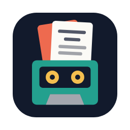

<h1 align="center">&nbsp;&nbsp;READ MY SCRIPT</h1>

<p align="center"><code>Mac app</code>&nbsp;&nbsp;<code>macOS 14+</code>&nbsp;&nbsp;<code>free · GPL-3.0</code></p>

<p align="center">☕ If you use Read my Script and like it, I would be glad if you <a href="https://buymeacoffee.com/moritzpoth">bought me a coffee</a>.</p>

Turns a screenplay PDF into an audiobook: a narrator reads the action, every role speaks with its own voice. The voices come from **VoiceStudio**, running on the same Mac – the script never leaves your computer.

*English · Deutsch · Français · Español – Settings (⌘,) → Language. Manual: Help → Read my Script Manual.*

> **Beta.** Please report problems in [Issues](../../issues).

## Features

- Reads screenplays from Final Draft, Fade In, Word and other programs, in German and English – scene headings, action, character names, parentheticals, dialogue, transitions. Page and scene numbers, headers and **watermarks** are left out.
- **One voice per role**, never shared unless you say so. Roles without a voice block the export, so no line goes missing unnoticed.
- **New voices** built by VoiceStudio from a few traits (gender, age, pitch, whisper) – listen, try another variant, save.
- Listen to every role before you start; right-click a paragraph to have it read by the narrator or left out.
- `.m4b` audiobook with **one chapter per scene**. Pause and resume; finished scenes are kept.
- Light or dark look, built-in manual in four languages, updates itself.

## Your script stays on this Mac

- The script only goes to VoiceStudio on `127.0.0.1`. A test in the code fails on any other network address.
- Internet only for GitHub: the update check (this project's releases) and, when you click Install VoiceStudio, VoiceStudio's official release. Neither contains anything from your scripts.
- The log file holds events and file names, never script text.
- The app switches off VoiceStudio's usage statistics, cloud sync and network sharing during setup and warns if they are on later.

## Install

Requires macOS 14 or later, Apple Silicon or Intel, and [VoiceStudio](https://github.com/debpalash/VoiceStudio) – if it is missing, Read my Script offers to install it (official release, checked for its developer's Apple signature and notarisation). Download `ReadMyScript-<version>.dmg` from [Releases](../../releases), open it and drag the app onto the Applications folder (so it can update itself). It is not signed with a paid Apple certificate: on first launch, open **System Settings → Privacy & Security** and click **Open Anyway** (once).

Making an audiobook takes roughly seven times its playing time on an Apple Silicon Mac – a 90-minute script runs about ten hours.

## Build

```
swift test                 # parser, render plan, localisation, manual
scripts/build-app.sh       # → dist/Read my Script.app and ReadMyScript-<version>.zip (+ .sig)
```

`Sources/ScriptCore` – PDF lines, screenplay parser, cast and render plan, VoiceStudio client (tested). `Sources/ReadMyScript` – the app. `Sources/rms-dump` – prints what the parser makes of a PDF.

## License

Copyright © 2026 Moritz Poth. Free software under the GNU General Public License v3.0 or later – see [LICENSE](LICENSE). No warranty. Font: [JetBrains Mono](https://www.jetbrains.com/lp/mono/) (SIL Open Font License, `Resources/fonts/OFL.txt`).

*VoiceStudio is a separate app with its own license. This project is not affiliated with it.*
